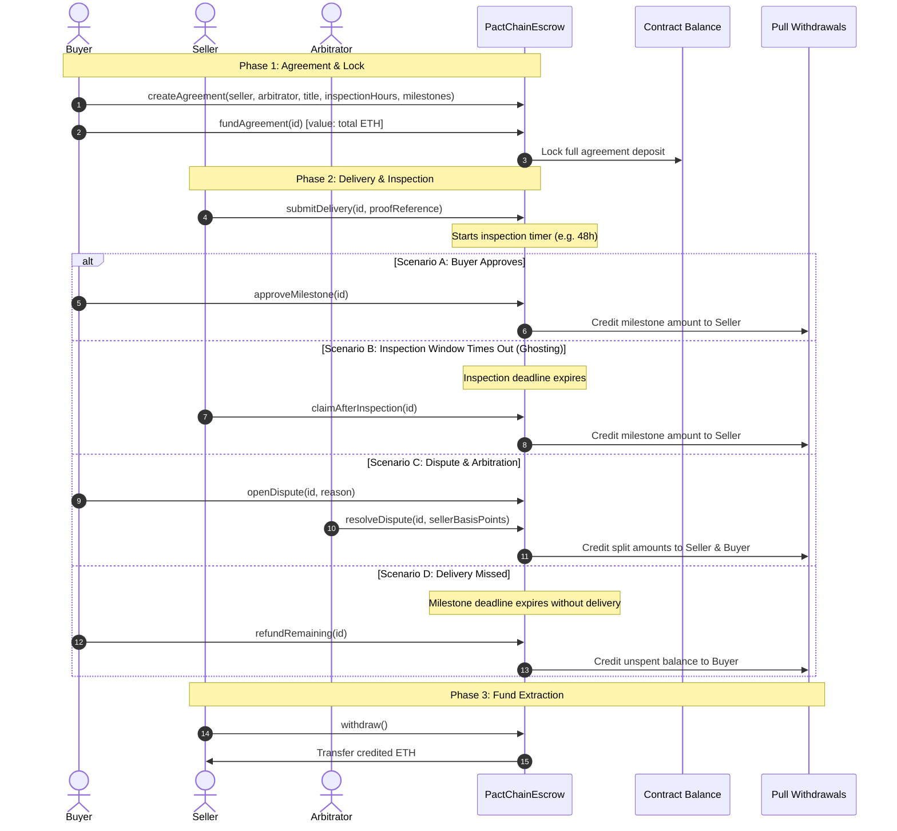

# PactChain · Every Promise Has a Plan

> **ALGOTHON’26 Submission** | **Track:** Blockchain (`ALG-BC-02`)  
> **Live Deployed Demo:** [https://pactchain-escrow.vercel.app](https://pactchain-escrow.vercel.app) *(Replace with your live Vercel URL)*  
> **Core Focus:** Trustless milestone-based ETH escrow with timeout protection, human arbitration, and pull-over-push withdrawals.

---

## 1. Executive Summary & Problem Understanding

Remote freelancing and digital contractor agreements face a persistent **two-sided trust dilemma**:
- **Buyers** fear paying upfront for incomplete, low-quality, or abandoned deliverables.
- **Sellers / Freelancers** fear delivering work without a guarantee of payment or getting ghosted by clients after submission.

**PactChain** resolves this deadlock through a Solidity smart contract escrow and an intuitive web workspace:
1. **Locked Commitment:** The buyer deposits the full agreement amount into smart-contract custody before work begins.
2. **Sequential Milestones:** Payment is released milestone-by-milestone, maintaining leverage and momentum.
3. **Ghosting Protection for Both Sides:** 
   - If the seller misses a delivery deadline, the buyer can reclaim all remaining unpaid funds.
   - If the buyer goes silent after delivery, the seller can claim the payout after the inspection window expires.
4. **Neutral Dispute Resolution:** A designated human arbitrator can allocate funds between buyer and seller if disputes occur.
5. **Pull-Over-Push Security:** Released funds accumulate in withdrawable credits to eliminate reentrancy and denial-of-service risks.

---

## 2. System Architecture & Technical Decisions

### System Architecture Diagram

```
+-----------------------------------------------------------------------------------+
|                                 USER INTERFACES                                   |
|                                                                                   |
|  +-------------------------------------+   +------------------------------------+  |
|  |     Landing Page (index.html)       |   |      Workspace App (app.html)      |  |
|  |  Interactive Canvas Orb + Motion    |   |   Agreement Board, Wizard, Room    |  |
|  +-------------------------------------+   +------------------------------------+  |
+------------------------------------------+----------------------------------------+
                                           |
                                           v
+-----------------------------------------------------------------------------------+
|                              CLIENT CONTROLLER LAYER                              |
|                                                                                   |
|  +---------------------+   +---------------------+   +-------------------------+  |
|  |    workspace.js     |   |   wallet-panel.js   |   |     chain-client.js     |  |
|  | State, UI Handlers  |   | Multi-Account Modal |   | Ethers Provider & Logic |  |
|  +---------------------+   +---------------------+   +-------------------------+  |
|             |                         |                           |               |
|             v                         v                           v               |
|  +---------------------+   +---------------------+   +-------------------------+  |
|  | workspace-state.js  |   |   local-wallet.js   |   |     contract-abi.js     |  |
|  | Offline Demo Engine |   | EIP-1193 Dev Bridge |   | Solidity Escrow ABI     |  |
|  +---------------------+   +---------------------+   +-------------------------+  |
+------------------------------------------+----------------------------------------+
                                           |
                    +----------------------+----------------------+
                    |                                             |
                    v                                             v
+---------------------------------------+     +-------------------------------------+
|        LOCAL / SIMULATED CHAIN        |     |          PUBLIC BLOCKCHAIN          |
|  Hardhat EVM (localhost:8545, 31337)  |     |  Sepolia Testnet / Ethereum Mainnet |
|  3 Unlocked Accounts (Buyer/Seller/Arb)|    |  MetaMask / Injected EIP-1193       |
+-------------------+-------------------+     +-------------------+-----------------+
                    |                                             |
                    +----------------------+----------------------+
                                           |
                                           v
+-----------------------------------------------------------------------------------+
|                              SMART CONTRACT LAYER                                 |
|                                                                                   |
|                           PactChainEscrow.sol (Solidity 0.8.37)                   |
|  - OpenZeppelin ReentrancyGuard                                                    |
|  - Custom Solidity Errors (Gas Optimized)                                         |
|  - Milestone State Machine: [Pending -> Delivered -> Released/Disputed/Refunded]  |
|  - Pending Withdrawals Mapping (Pull Payment Pattern)                              |
+-----------------------------------------------------------------------------------+
```

### Major Technical Decisions & Rationale

| Decision | Implementation | Why Chosen |
|---|---|---|
| **Pull-over-Push Payments** | `pendingWithdrawals[recipient] += amount;` followed by explicit `withdraw()` | Prevents DoS attacks from malicious receiving contracts and eliminates reentrancy vectors. |
| **Strict State Transitions** | Custom Solidity errors (`InvalidState`, `Unauthorized`, `DeadlinePassed`, `TooEarly`) | Reverts immediately with low gas cost instead of generic strings; guarantees non-skippable progression. |
| **Dual-Mode Execution** | Blockchain Mode (MetaMask / Hardhat) + Standalone Interactive Demo Mode | Ensures the app is 100% testable on Vercel without requiring users to install browser extensions or configure RPCs. |
| **Reorg-Resilient Event Scanning** | `chain-client.js` scans recent tail blocks (`scannedTo - 5`) | Handles short chain reorganizations smoothly without dropping agreement history or corrupting local state. |
| **Lightweight Vanilla Architecture** | ES Modules + CSS Grid + Canvas (Zero build-step runtime) | Blazing fast load times, zero bundle bloat, zero SSR hydration mismatches on static hosts like Vercel. |

---

## 3. Core Workflow Demonstration



---

## 4. Testing Evidence & Edge Cases

The project contains **42 automated test cases** across contract execution, wallet adapters, history reorgs, and state accounting:

```
✔ escrow.test.js (21 tests)
  ✔ creates agreements with valid parameters and distinct roles
  ✔ rejects duplicate participants or ZeroAddress
  ✔ requires exact deposit match on fundAgreement()
  ✔ enforces increasing deadlines and 1-5 milestone bounds
  ✔ restricts delivery submission to assigned seller
  ✔ enforces inspection window before claimAfterInspection()
  ✔ allows seller timeout claim when buyer does not respond
  ✔ allows buyer refund after milestone deadline expires
  ✔ allows dispute opening during inspection window
  ✔ restricts dispute resolution to agreed arbitrator
  ✔ prevents double-withdrawal via ReentrancyGuard
  ✔ preserves pending withdrawal credit if ETH transfer reverts (TestReceiver)
  
✔ chain-client.test.js (12 tests)
  ✔ connects EIP-1193 injected provider and switches chain ID
  ✔ parses contract events and structures agreement models
  ✔ handles short reorgs and logs cursors accurately
  
✔ local-wallet.test.js (9 tests)
  ✔ signs with unlocked local Hardhat accounts
  ✔ enforces loopback security restrictions
  ✔ rejects unauthorized transaction targets
```

### Critical Edge Cases Handled

1. **Malicious / Reverting Receiver Contract:** When a recipient's fallback function reverts during withdrawal, the contract does not revert or lose funds; the recipient's withdrawal credit remains intact for later retry (`TestReceiver.sol`).
2. **Chain Reorganizations:** `chain-client.js` scans backwards 5 blocks from the last committed block cursor to catch orphaned blocks and update history.
3. **Deadlocks & Buyer Disappearance:** If a buyer fails to review deliverables, the seller can unilaterally claim payment once `inspectionEnd` passes.
4. **Deadlocks & Seller Abandonment:** If a seller misses a delivery deadline, the buyer can unilaterally claim a refund of all remaining unpaid milestones.

---

## 5. Known Limitations & Future Roadmap

| Area | Current Implementation | Planned Improvement |
|---|---|---|
| **Currency** | Native ETH | Support ERC-20 stablecoins (USDC, USDT, DAI) to protect against crypto volatility. |
| **Arbitration** | Single designated human arbitrator | Decentralized arbitration network (e.g. Kleros integration or multi-sig panel). |
| **File Storage** | URI/hash strings (GitHub PR, IPFS CID) | Native browser-based IPFS / Arweave drag-and-drop file upload. |
| **Milestone Scalability** | Capped at 5 milestones per agreement | Dynamic pagination to allow up to 20+ milestones for complex enterprise projects. |

---

## 6. Disclosures

- **External Libraries & Frameworks:** 
  - `OpenZeppelin Contracts v5.6.1` (`ReentrancyGuard.sol`)
  - `Ethers.js v6.17.0` (Client-side blockchain interaction)
  - `Hardhat v3.18.1` (Local EVM compilation, testing, and deployment)
  - `solc v0.8.37` (Solidity compiler with Cancun EVM target)
- **AI-Assisted Components:** AI tooling was utilized for code refactoring, test scenario expansion, and documentation drafting in accordance with the **ALGOTHON’26 Principle: "AI may help you build it. But you still have to make it work."**

---

## 7. How to Run Locally

### Prerequisites
- **Node.js 24 LTS** (recommended v24.12.0+)
- Windows, macOS, or Linux terminal

### Step 1: Install Dependencies
```bash
npm ci --ignore-scripts
```

### Step 2: Run Automated Tests
```bash
npm test
```

### Step 3: Start Local Blockchain & Deploy
In **Terminal 1** (Start local EVM node):
```bash
npm run chain
```

In **Terminal 2** (Deploy contract & seed demo deals):
```bash
npm run deploy:local
npm run demo:chain
```

In **Terminal 3** (Launch frontend):
```bash
npm run dev
```
Open [http://127.0.0.1:5173](http://127.0.0.1:5173) in your browser.

---

## 8. Alignment with Evaluation Criteria

| Criteria | Weight | How PactChain Delivers |
|---|---|---|
| **Functionality & Completion** | **30%** | Full lifecycle works end-to-end: Agreement -> Fund -> Deliver -> Review -> Dispute/Timeout -> Withdraw. |
| **Technical Implementation** | **20%** | Production-grade Solidity 0.8.37, OpenZeppelin security, pull-payment pattern, reorg-safe event scanner. |
| **Innovation & Problem Understanding** | **20%** | Direct solution to the two-sided freelance trust problem with timeout claims and human arbitration. |
| **User Experience & Presentation** | **15%** | Extension-free test wallets for zero-friction evaluation, animated landing page, clean responsive design. |
| **Testing, Edge Cases & Reliability** | **15%** | 42 passing tests, reverting receiver tests, chain reorg tests, and clear timeout handling. |
